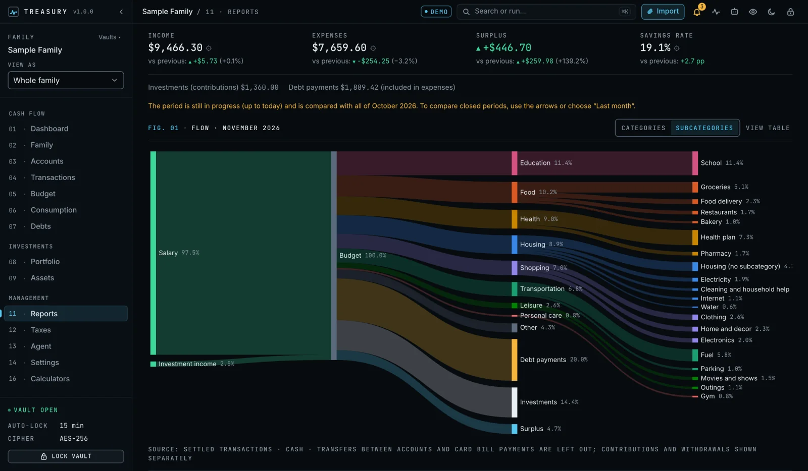

# Treasury

> Family finances and investments, local-first, encrypted, with an optional AI agent.
> *Measured, never invented: every number has a traceable source.*

[Português](README.pt-BR.md)

Treasury is a desktop app for a family to keep all of its money in one place: bank accounts,
credit cards, budget, debts, property, investments and taxes. The data stays on your computer, in
an encrypted database, and an optional AI agent helps analyze and record things, always asking for
approval first.



## What it does

- **Cash flow**: accounts, credit cards (statements, additional cards, limits, fees, cashback and
  points), transactions with categories, splits, rules and recurrences, budget, goals and spending
  groups, per family member.
- **Imports**: OFX/CSV statements, card statements and brokerage notes in PDF, B3 investor reports,
  payslips, receipts (Brazilian NFC-e, photos read by local OCR), e-mail ingestion and a watched
  inbox folder. Everything is previewed and deduplicated before it is saved.
- **Debts and property**: loans and mortgages (fixed rate, CDI/Selic, inflation-indexed),
  amortization simulations, payoff plans, real estate and vehicles with valuations.
- **Investments**: portfolio with average cost, realized and unrealized results, TWR and XIRR,
  **real** returns (deflated by the country's inflation, CPI or M2), risk, concentration, sales
  ledger, fundamentals, rankings, screener, a market explorer and a health score per asset.
- **Taxes**: Brazilian income tax on investments (monthly assessment, DARF, annual report) and an
  estimate of all the taxes the family paid in the year.
- **Planning**: balance forecast, "how much can I spend today", subscriptions, what-if scenarios,
  retirement (Monte Carlo, with the public pension rules of Brazil, the US and Portugal) and a
  "next step" guide for people who are just starting.
- **AI agent and MCP**: the app exposes all its features as an **MCP server** (`treasury mcp`).
  The built-in agent and external MCP clients use the same tools; writes become proposals that you
  approve, with undo and an audit log. Engines: APIs, local agent CLIs that use your own
  subscription, or local models through an endpoint.
- **Countries and languages**: complete for Brazil, adapted for the US, Portugal, Spain, the UK,
  Canada, France, Germany, Argentina and Chile, generic elsewhere. Interface in Brazilian
  Portuguese, English and Spanish (European Portuguese partially).

## Security and privacy

- One SQLite + SQLCipher (AES-256) file per vault, with a key derived from your master password by
  Argon2id. Touch ID, PIN, FIDO2 keys and 2-of-3 split recovery are optional.
- Managed, encrypted and verified backups, with rotation and recovery when the vault does not open.
- No telemetry. The internet is used only for market data, indices and the AI engine you choose,
  and each data source can be turned off.
- The MCP server always requires an API key you create, and external clients only read or propose.

- **Only the maintainer publishes versions.** Packages are built by GitHub Actions with public
  build provenance, then signed on the maintainer's computer with a hardware key (YubiKey, touch
  and PIN). Every installed Treasury refuses an update without that signature, so a hijacked
  GitHub account or CI cannot ship a version. Why and how to check: [docs/trust.md](docs/trust.md).
- Known vulnerabilities in dependencies (RustSec and npm) block every release.

Details: [docs/security.md](docs/security.md) and [docs/local-security.md](docs/local-security.md).
To report a vulnerability, see [SECURITY.md](SECURITY.md).

## Platforms

| System | Package | Status |
|---|---|---|
| macOS (Apple Silicon) | `.dmg` | Used daily; automatic updates |
| Linux (x86_64) | AppImage, `.deb`, `.rpm` | Built by CI; automatic updates; install checked on Ubuntu 22.04/24.04, Debian 12/13 and Fedora 42 (update not yet tested) |
| Windows (x64) | NSIS installer, `.msi` | Built by CI; automatic updates; preview, no code signing yet |

The macOS build is not notarized yet: on first launch, allow it in System Settings › Privacy &
Security. Check downloads against `SHA256SUMS.txt` ([docs/distribution.md](docs/distribution.md)). The
AppImage needs FUSE (`fuse3`) and the system EGL/GLES libraries (`libegl1`, `libgles2`), already
present on most desktops.

## Build from source

Requirements: Rust 1.92 or newer, Node.js 22 and, on Linux, the WebKitGTK libraries listed in
[.github/workflows/ci.yml](.github/workflows/ci.yml).

```bash
cargo test -p treasury-core
```

```bash
cd apps/desktop && npm ci && npm run tauri dev
```

The full guide (repository layout, running the UI against the real core, end-to-end tests,
release builds for macOS, Linux and Windows) is in [docs/development.md](docs/development.md).

## Documentation

The documents in [docs/](docs/README.md) are in Brazilian Portuguese: product vision, decisions,
architecture, each feature, data sources and validation records.

## Contributing

Bug reports, ideas, translations and code are welcome, in Portuguese, English or Spanish. Never
attach real statements or screenshots with values: use the demo vault.

Releases are built and signed exclusively by the project owner, Knuppe, because people trust
Treasury with their financial life. Contributions that do not fit the project's vision may be
declined without discussion; open an issue before starting anything large. See
[CONTRIBUTING.md](CONTRIBUTING.md) and the [Code of Conduct](CODE_OF_CONDUCT.md).

## Disclaimer

Treasury is a tool to organize and study your own data. Its analyses, scores and simulations are
not investment, tax or legal advice. See the terms of use shown on first launch
([docs/terms.md](docs/terms.md)).

Treasury is a personal open-source project. It is not affiliated with, endorsed by or connected to
any company, bank, government body or other product that uses the word "treasury" in its name.

## License

[GNU AGPL-3.0-only](LICENSE). Contributions are accepted under the same license with a DCO
sign-off (`git commit -s`). Third-party components and embedded data: [NOTICE](NOTICE) and
[DATA_LICENSES.md](DATA_LICENSES.md).
