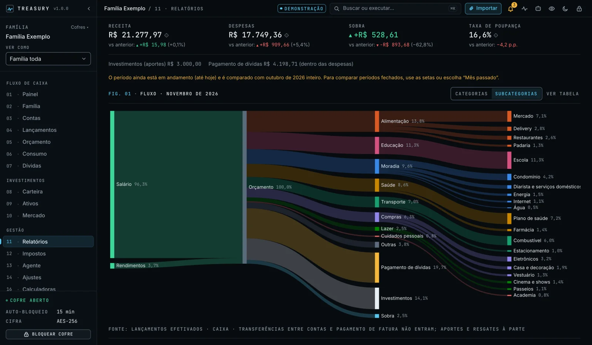

# Treasury

> Finanças da família e investimentos, local-first, cifrado, com um agente de IA opcional.
> *Medido, nunca inventado: todo número tem origem rastreável.*

[English](README.md)

**[Baixar a versão mais recente](https://github.com/knuppe/treasury/releases/latest)** · [Guia de
instalação passo a passo](https://knuppe.github.io/treasury-site/pt/installation/) · [Como instalar](#instalar)

O Treasury é um aplicativo de computador para a família cuidar do dinheiro inteiro num lugar só:
contas, cartões, orçamento, dívidas, bens, investimentos e impostos. Os dados ficam no
computador, num banco cifrado, e um agente de IA opcional ajuda a analisar e a cadastrar, sempre
com aprovação.



## O que faz

- **Fluxo de caixa**: contas, cartões de crédito (faturas, adicionais, limite, custos, cashback e
  pontos), lançamentos com categorias, divisão, regras e recorrências, orçamento, metas e grupos
  de gasto, por membro da família.
- **Importação**: extratos OFX/CSV, faturas e notas de corretagem em PDF, relatórios da Área do
  Investidor B3, holerites, cupons fiscais (NFC-e e fotos lidas por OCR local), e-mail de ingestão
  e uma pasta de entrada. Tudo passa por prévia e deduplicação antes de gravar.
- **Dívidas e bens**: empréstimos e financiamentos (pré, CDI/Selic e corrigidos por índice),
  simulações de amortização, plano de quitação, imóveis e veículos com avaliações.
- **Investimentos**: carteira com preço médio, resultado realizado e não realizado, TWR e XIRR,
  resultado **real** (descontando a inflação do país, o CPI ou o M2), risco, concentração, livro de
  vendas, fundamentos, rankings, screener, o explorador do Mercado e um score de saúde por ativo.
- **Impostos**: IR de investimentos no Brasil (apuração mensal, DARF, relatório anual) e a
  estimativa de todos os impostos que a família pagou no ano.
- **Planejamento**: previsão de saldo, "quanto posso gastar hoje", assinaturas, cenários "e se",
  aposentadoria (Monte Carlo, com as regras públicas do Brasil, dos EUA e de Portugal) e o
  "próximo passo" para quem está começando.
- **Agente de IA e MCP**: o app expõe as suas funções como **servidor MCP** (`treasury mcp`). O
  agente do app e os clientes MCP externos usam as mesmas ferramentas; as escritas viram propostas
  que você aprova, com desfazer e auditoria. Motores: APIs, CLIs locais de agentes com a sua
  assinatura ou modelos locais por endpoint.
- **Países e idiomas**: completo para o Brasil; adaptado para EUA, Portugal, Espanha, Reino Unido,
  Canadá, França, Alemanha, Argentina e Chile; genérico nos outros. Interface em português do
  Brasil, inglês e espanhol (português de Portugal parcial).

## Segurança e privacidade

- Um arquivo SQLite + SQLCipher (AES-256) por cofre, com a chave derivada da senha mestra por
  Argon2id. Touch ID, PIN, chaves FIDO2 e recuperação dividida 2 de 3 são opcionais.
- Backups gerenciados, cifrados e verificados, com rotação e recuperação quando o cofre não abre.
- Sem telemetria. A internet só traz dados de mercado, índices e o motor de IA que você escolher,
  e cada fonte de dados pode ser desligada.
- O servidor MCP sempre exige uma chave de API criada por você, e clientes externos só leem ou
  propõem.

- **Só o mantenedor publica versões.** Os pacotes são compilados no GitHub Actions, com
  atestação pública de proveniência, e assinados no computador do mantenedor com uma chave
  física (YubiKey, toque e PIN). Todo Treasury instalado recusa atualização sem essa assinatura:
  uma conta do GitHub ou um CI invadidos não conseguem entregar uma versão. Por que e como
  conferir: [docs/trust.md](docs/trust.md).
- Vulnerabilidades conhecidas nas dependências (RustSec e npm) barram qualquer release.

Detalhes em [docs/security.md](docs/security.md) e [docs/local-security.md](docs/local-security.md).
Para relatar uma falha, veja o [SECURITY.md](SECURITY.md).

## Instalar

Não precisa saber programar. Leva uns cinco minutos.

1. Abra a página da [versão mais recente](https://github.com/knuppe/treasury/releases/latest).
2. Desça até a seção **Assets** no fim da página. Se só aparecerem dois arquivos "Source code",
   clique em **Assets** para mostrar a lista inteira.
3. Baixe **um arquivo só**, o do seu computador:

| Seu computador | Arquivo para baixar |
|---|---|
| Mac com chip Apple (M1 ou mais novo) | `Treasury_<versão>_aarch64.dmg` |
| Ubuntu, Debian, Linux Mint, Pop!_OS | `Treasury_<versão>_amd64.deb` |
| Fedora, openSUSE | `Treasury-<versão>-1.x86_64.rpm` |
| Qualquer outro Linux | `Treasury_<versão>_amd64.AppImage` |
| Windows 10 ou 11 | `Treasury_<versão>_x64-setup.exe` |

Não sabe qual é o seu Mac? Abra o menu Apple › **Sobre Este Mac**: se em "Chip" aparecer Apple M1,
M2, M3 ou mais novo, esta versão serve. Macs com processador Intel não são compatíveis.

Pode ignorar todos os outros arquivos da página. Os `.sig`, o `latest.json`, o `allowed_signers` e o
`.app.tar.gz` são usados pela atualização automática e por quem confere assinaturas, o `.msi` é
para empresas que instalam programas em muitos computadores, e o `SHA256SUMS.txt` serve para a
[conferência opcional](#conferir-o-download-opcional) mais abaixo.

### macOS

O app do macOS ainda não é notarizado pela Apple, então o macOS bloqueia a primeira abertura. Uma
vez por instalação:

1. Abra o `.dmg` baixado e arraste o **Treasury** para a pasta **Aplicativos**.
2. Abra o Treasury pelos Aplicativos. O macOS avisa que ele "não pode ser verificado"; clique em
   **OK** (não em "Mover para o Lixo").
3. Abra Ajustes do Sistema › Privacidade e Segurança, desça até o aviso sobre o Treasury e clique
   em **Abrir Mesmo Assim**; confirme com a senha ou o Touch ID.
4. O Treasury abre. Daí em diante ele abre normalmente, e as atualizações se instalam sozinhas.

### Linux

- **`.deb`**: dê dois cliques no arquivo e clique em **Instalar** na central de programas, ou rode
  `sudo apt install ./Treasury_*_amd64.deb` na pasta Downloads. Depois abra o **Treasury** pelo menu
  de aplicativos.
- **`.rpm`**: dê dois cliques no arquivo e clique em **Instalar**, ou rode
  `sudo dnf install ./Treasury-*-1.x86_64.rpm` (no openSUSE, `sudo zypper install ...`).
- **AppImage**: clique com o botão direito no arquivo › **Propriedades** › **Permissões** e ligue
  **Permitir execução do arquivo como programa** (ou rode `chmod +x Treasury_*_amd64.AppImage`), e
  depois dê dois cliques nele. Ele precisa do FUSE (`fuse3`) e das bibliotecas EGL/GLES do sistema
  (`libegl1`, `libgles2`), que a maioria dos desktops já tem. Se não abrir, rode
  `sudo apt install fuse3 libegl1 libgles2` e tente de novo. Guarde o arquivo numa pasta fixa, como
  `~/Applications`.

### Windows

1. Dê dois cliques em `Treasury_<versão>_x64-setup.exe`.
2. O instalador ainda não tem assinatura de código, então o SmartScreen mostra "O Windows protegeu
   o computador": clique em **Mais informações** e depois em **Executar assim mesmo**.
3. Siga o instalador e abra o **Treasury** pelo menu Iniciar.

### Deu certo?

Na primeira vez, o Treasury pergunta o idioma, mostra os termos de uso e oferece um cofre de
**demonstração** (uma família fictícia, para explorar sem digitar nada) ou um cofre **real**,
protegido por uma senha mestra. A versão instalada aparece em Ajustes › Atualizações.
Próximos passos: [primeiros passos](https://knuppe.github.io/treasury-site/pt/getting-started/).

### Conferir o download (opcional)

Cada versão traz um `SHA256SUMS.txt` com a impressão digital de cada arquivo. Coloque-o na mesma
pasta do arquivo baixado e rode `shasum -a 256 -c --ignore-missing SHA256SUMS.txt` no macOS ou
`sha256sum -c --ignore-missing SHA256SUMS.txt` no Linux; a linha do seu arquivo precisa terminar
em `OK`. No Windows, compare a saída de `Get-FileHash .\Treasury_*_x64-setup.exe` no PowerShell
com a linha do arquivo. Como conferir também a assinatura do mantenedor:
[docs/distribution.md](docs/distribution.md).

### Situação de cada sistema

| Sistema | Pacote | Situação |
|---|---|---|
| macOS (Apple Silicon) | `.dmg` | Uso diário; atualização automática |
| Linux (x86_64) | AppImage, `.deb`, `.rpm` | Gerado pelo CI; atualização automática; instalação conferida no Ubuntu 22.04/24.04, Debian 12/13 e Fedora 42 (atualização ainda sem teste) |
| Windows (x64) | instalador NSIS, `.msi` | Gerado pelo CI; atualização automática; pré-visualização, ainda sem assinatura de código |

Os dados ficam na pasta `.treasury` dentro da sua pasta pessoal, fora do app, então atualizar ou
desinstalar o Treasury não apaga nada. Como desinstalar e outros detalhes:
[guia de instalação](https://knuppe.github.io/treasury-site/pt/installation/).

## Compilar

Requisitos: Rust 1.92 ou mais novo, Node.js 22 e, no Linux, as bibliotecas do WebKitGTK listadas
em [.github/workflows/ci.yml](.github/workflows/ci.yml).

```bash
cargo test -p treasury-core
```

```bash
cd apps/desktop && npm ci && npm run tauri dev
```

O guia completo (estrutura do repositório, interface contra o núcleo real, testes ponta a ponta,
builds de release para macOS, Linux e Windows) está em [docs/development.md](docs/development.md).

## Documentação

O índice está em [docs/README.md](docs/README.md): visão do produto, decisões, arquitetura, cada
funcionalidade, fontes de dados e registros de validação. A documentação é escrita em inglês;
alguns documentos têm uma cópia em português ao lado (`*.pt-BR.md`).

## Como contribuir

Relatos de erro, ideias, traduções e código são bem-vindos, em português, inglês ou espanhol.
Nunca anexe extratos reais nem prints com valores: use o cofre de demonstração.

As versões são compiladas e assinadas exclusivamente pelo dono do projeto, o Knuppe, porque as
pessoas confiam a vida financeira ao Treasury. Contribuições que não combinam com a visão do
projeto podem ser recusadas sem discussão; abra um issue antes de começar algo grande. Veja o
[CONTRIBUTING.md](CONTRIBUTING.md) e o [Código de Conduta](CODE_OF_CONDUCT.md).

## Aviso

O Treasury é uma ferramenta para organizar e estudar os seus próprios dados. As análises, os
scores e as simulações não são recomendação de investimento nem orientação tributária ou jurídica.
Veja os termos de uso, mostrados na primeira abertura ([docs/terms.md](docs/terms.md)).

O Treasury é um projeto pessoal de código aberto. Não tem vínculo, endosso nem relação com nenhuma
empresa, banco, órgão de governo ou outro produto que use a palavra "treasury" no nome.

## Licença

[GNU AGPL-3.0-only](LICENSE). Contribuições entram sob a mesma licença, com a linha
`Signed-off-by` do DCO (`git commit -s`). Componentes de terceiros e dados embutidos:
[NOTICE](NOTICE) e [DATA_LICENSES.md](DATA_LICENSES.md).
